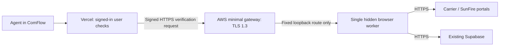

# AWS worker pilot plan — review only, 2026-11-07

**Nothing in this plan has been provisioned.** It does not authorize creating AWS resources, buying a domain, changing DNS, copying credentials, enabling hosted sync, importing statements or changing GHL. Keep it on `feature/ghl-contact-preview`; Main stays unchanged.

## Recommendation and cost

Start with **one Linux t3.medium in US East (Ohio), `us-east-2`**, running one worker and the minimal verification gateway. It has two vCPUs and 4 GiB RAM, matching the tested x86_64 images. This is a modest single-user/small-pilot starting point, not a capacity or availability guarantee. Use T3 **Standard** credits; heavy sustained CPU can throttle rather than incur Unlimited-credit charges. Review resizing if browser runs exhaust credits.

Estimate **about $43/month before tax**, with a **$50 monthly AWS budget alert**. This is the incremental AWS downloader cost, not the total ComFlow bill. Ryan plans to purchase a new domain later; domain registration/renewal is excluded and no existing TruePlan domain will be used automatically.

| Planned item | Assumption | Approximate monthly USD |
| --- | --- | ---: |
| EC2 Linux t3.medium | 730 hours × $0.0416 | $30.37 |
| One Elastic/public IPv4 | 730 hours × $0.005 | $3.65 |
| Encrypted gp3 root disk | 40 GiB × $0.08 | $3.20 |
| Encrypted gp3 state disk | 10 GiB × $0.08 | $0.80 |
| Standard state snapshots | 20 GiB retained × $0.05 | $1.00 |
| One grouped Secrets Manager secret | $0.40 plus about 100 reads | $0.40 + less than $0.01 |
| Private ECR images | 10 GB retained × $0.10 | $1.00 |
| CloudWatch allowance | Small operational logs, two custom metrics, five alarms | $2.00 |
| Outbound traffic allowance | 2 GB × $0.09, ignoring any free quota | $0.18 |
| Optional Route 53 DNS | One zone and 10,000 standard queries | $0.51 |
| **Estimated total** | Unrounded calculation, displayed rows rounded | **$43.10** |

A 744-hour month is about **$43.76** with the other assumptions unchanged. Higher storage, logs or traffic can exceed these allowances. A budget alert is not a hard spending cap. Use notifications around $40 actual and $50 actual/forecast, with the owner recipient chosen before creation. No alert or email subscription has been created.

No free-tier credits, promotions or purchase commitments are assumed. Default included gp3 performance is sufficient for this pilot; do not buy extra IOPS/throughput initially. Use AWS-managed EBS/Secrets Manager encryption keys rather than paid customer-managed keys in this estimate. The Route 53 lines can be removed if the future registrar provides suitable DNS automation. Certificate issuance is planned through a free public CA, with no paid load balancer, NAT Gateway, RDS, ECS or EKS in this pilot.

The estimate excludes tax, the new domain, existing Vercel/Supabase charges and any required provider/security/compliance plan changes, paid support and a high-availability architecture. AWS BAA/account agreement status and applicable existing-provider requirements still need checking before any real-client-data pilot. AWS availability of an agreement is not proof that this account has accepted it or that the full product is compliant.

Rates were checked against public AWS pricing, not the signed-in account's bill. EC2's Ohio rate feed was published 2026-11-07; the regional gp3 and snapshot CSV rates were effective 2026-11-01. Exact SKUs, sources and quantities are in [`aws-pilot-costs.json`](../worker/hosting/aws-pilot-costs.json). Run `node scripts/estimate-aws-worker.mjs` for local arithmetic; it makes no network calls. Recheck prices and final account/service settings immediately before an approved launch.

## Proposed resources (not created)

| Resource | Proposed setting |
| --- | --- |
| AWS account | Ryan-controlled account; verify account ID, admin access and MFA before approval. No account inventory was claimed or changed here. |
| Region | Ohio `us-east-2`, aligned with the console region used during setup and verified rates. |
| Network | One dedicated pilot VPC, one public subnet in a selected Ohio AZ, an Internet Gateway and a subnet route. Select a non-overlapping CIDR after checking the actual account. No NAT Gateway. |
| Compute | One On-Demand Linux `t3.medium`, x86_64, one replica, fixed container hostname, T3 Standard, termination protection. Resolve and verify the current Canonical Ubuntu 24.04 LTS amd64 AMI at deployment; do not paste an unverified AMI ID. |
| Metadata/access | IMDSv2 required, hop limit 1, host instance role. No static AWS access keys in the app, browser, repository or container. Block container access to instance metadata as defense in depth. |
| Storage | 40 GiB encrypted gp3 root disk; separate 10 GiB encrypted gp3 state disk in the same AZ, retained on instance replacement. Confirm the state mount before starting Docker so a missing mount cannot silently create an empty replacement state. |
| Public address | One Elastic IP and one future DNS A record. No extra idle IPs. |
| Registry | Two private ECR repositories, worker and gateway, scanned immutable image digests, retain the current and previous approved releases. No client records or secrets in images. |
| Secrets | One Secrets Manager JSON object for the Supabase service-role key, existing credential-encryption key and new verification relay key. Public URL/config is separate. Preserve the existing encryption key so saved logins remain readable. |
| Backups | Weekly snapshots of the state disk, retain two, using EBS Data Lifecycle Manager. The 20 GiB allowance covers two full 10 GiB copies conservatively; actual incremental billing may be lower. The root disk is rebuilt from reviewed setup and immutable images. These cover worker state, not the Supabase database/source-file backup plan. This is a backup schedule, not a statement collection schedule. |
| Monitoring | Rotated operational logs, short CloudWatch retention, instance status/CPU/credit checks plus host health and disk checks; budget notifications. No PHI, statement text, MBIs, passwords, codes, request bodies or screenshots in logs. |

## Network and container boundaries

The website stays on Vercel; the database and private source files stay in Supabase. This plan moves only the downloader/verification worker off Ryan's computer. It does not move or reimport existing records.

Inbound rules: **443 only** for the HTTPS verification service. Vercel's current deployment does not have a verified fixed egress IP, so do not claim an IP allowlist exists; signed short-lived requests and worker owner checks remain mandatory. No inbound SSH/RDP, port 80, relay 8080, gateway internal 8443, browser debugging or remote-desktop ports. Administer the host through authorized AWS Systems Manager sessions.

Use an ordinary Docker bridge for reviewed outbound HTTPS and DNS access rather than the rehearsal's `network_mode: none`. Publish host `443` to namespace `8443` on the **worker** service, because the gateway shares that worker network namespace. Keep the relay listening only at `127.0.0.1:8080`. Configure Docker/firewall and security groups together; do not rely on a host firewall rule that Docker port publishing bypasses. Allow outbound HTTPS to carrier/CDN, Supabase, ECR, Secrets Manager and Systems Manager endpoints. DNS and time synchronization must work. Prefer HTTPS package repositories for host patching; review any additional egress need during the pilot rather than opening arbitrary ports.

Retain non-root UID 1001, read-only root filesystems, dropped host capabilities, no-new-privileges, Chromium sandbox and the reviewed seccomp profile. Use one persistent state mount and the existing kernel lock. Only one worker may serve this Supabase queue; stop the local worker before cutover. Keep collection scheduling explicitly **off**. A host failure requires manual restoration; this is not a multi-host/distributed worker design.

## Domain and certificate plan

Use `verify-staging.<new-domain>` as a placeholder until Ryan buys and chooses the domain. DNS automation and a publicly trusted certificate are launch prerequisites; do not use the local self-signed rehearsal certificate online or disable certificate verification.

Propose a free Let's Encrypt certificate through DNS-01 validation, renewed by a host-side ACME client. If using Route 53, permit only challenge TXT changes for `_acme-challenge.verify-staging.<new-domain>` in the selected zone; keep DNS credentials/instance-role access out of the gateway container. This avoids exposing port 80. Domain and DNS ownership must be confirmed before any record or certificate request is made.

Install the certificate/key in a dedicated protected host directory on the encrypted state disk, separate from journals and runtime secrets. Mount **only that certificate directory read-only** into the gateway; never give it the worker state or Supabase/relay secret file. The worker does not need the TLS private key. Use group-readable key permissions for UID/GID 1001, restrict parent-directory access, and update certificate/key atomically as a pair.

The gateway loads its certificate at startup. A successful renewal must validate the new chain/key and gracefully restart **only the gateway**, preserving the worker browser/MFA session. Monitor renewal and expiry; never assume renewal alone updates the running process. The host-side renewal/deployment hook is implemented and locally tested; actual issuer and host integration remain pending. See [deployment scripts review](aws-deployment-scripts-review.md). Do not substitute a free non-exportable ACM certificate for a certificate file; an exportable ACM certificate is a separate priced alternative and is not included here.

## Access, secrets and operations

The future instance role should have SSM core access, image-pull access to only the two repositories, read access to only the one runtime secret, and narrowly scoped monitoring/DNS permissions. ECR token retrieval and some SSM/DNS discovery actions require resource-wide scope; isolate those statements rather than granting broad administrator access. Use a separate human/deployment role for resource creation and image publishing. Do not give agents AWS console or SSM access.

Fetch the secret on the host at approved startup/rotation into `/run/comflow/worker.env`, a root-owned `0600` file in a root-only directory on temporary runtime storage. Regenerate it after reboot; the worker alone receives those values. Avoid secret values in user-data, build arguments, command-line flags, shell history or logs. Treat Docker/root/SSM administrators as privileged secret readers. The same relay key is stored as a server-only Vercel secret; never use a `NEXT_PUBLIC_` name. Changing the saved-login encryption key requires a deliberate migration, not an incidental deployment rotation.

Start the exact previously scanned image digests under systemd/Docker, with resource limits, local log rotation and restart-on-process-exit behavior. Do not build software on the pilot server. Health monitoring must distinguish a normal MFA wait from a dead process; never restart a working browser simply because it is waiting for the agent's code. Current rehearsal readiness files are synthetic fixtures, not production health checks. Production health checks and secret/certificate hooks now have isolated local tests; actual AWS deployment rehearsal remains required before live enablement.

Proposed monitoring allowance assumes 1 GB log ingestion, up to 1 GB retained archived logs, two custom metrics (disk percentage and aggregate worker/gateway/certificate health), and five standard metric alarms using those plus EC2 status/CPU/credit metrics. It is a usage allowance, not a flat CloudWatch product price. Alerts notify the owner; they do not automatically resubmit a login, code or statement import.

If stopped but retained, disks, IP, snapshots, ECR, secret and DNS continue billing. Roughly $11–13/month can remain while EC2 compute is stopped, depending on which monitoring/usage allowances continue. Termination, IP release and retained-volume deletion are separate explicit actions; do not delete state or imported records as a cost-control shortcut.

## Approval and rollout sequence

1. **Now:** review this plan and approximately $43/month worker-only estimate. No resources are created by reviewing or running the local calculator.
2. **Resolve before creation:** Ryan buys/chooses the new domain; confirm its DNS provider, the target AWS account/region and owner notification address, applicable account agreements, AMI and exact reviewed access/resource settings. Recheck prices and current image scans. Domain purchase remains a separate user action.
3. **Prepare final deployment review:** implement and locally rehearse the concrete host bootstrap, secret handling, TLS renewal, health checks and rollback. Present the exact resource change list and costs for approval before provisioning. The infrastructure template and host scripts now pass offline tests; see [coverage and remaining installation work](aws-deployment-scripts-review.md). This is not an instruction to apply them now.
4. **Only after explicit approval:** create the listed resources and trusted certificate. Start with synthetic fixtures and outbound carrier access disabled; verify IAM isolation, volume permissions, restart recovery and TLS from Vercel. Do not point a second worker at the current queue.
5. **Separate live pilot approval:** pause the local queue consumer, verify there is no active MFA/download, switch one carrier connection to the hosted worker, and confirm hidden collection/MFA/duplicates. Any import or GHL writes remain subject to the live pilot's explicit scope. Keep scheduling off.
6. **Rollback:** stop the hosted consumer first; preserve state and its audit trail. Only after confirming it is stopped, restore the previously approved local consumer. Do not restore or modify the Supabase ledger as part of worker rollback. Images and state backup restoration must not cause automatic replay of an uncertain code/login/import.

## Official pricing and setup sources

- [EC2 On-Demand pricing](https://aws.amazon.com/ec2/pricing/on-demand/) and the regional source/SKU in the JSON estimate.
- [EBS pricing](https://aws.amazon.com/ebs/pricing/), [EBS lifecycle backups](https://docs.aws.amazon.com/ebs/latest/userguide/snapshot-lifecycle.html).
- [Public IPv4 pricing](https://aws.amazon.com/vpc/pricing/), [Secrets Manager](https://aws.amazon.com/secrets-manager/pricing/), [ECR](https://aws.amazon.com/ecr/pricing/).
- [CloudWatch](https://aws.amazon.com/cloudwatch/pricing/), [Route 53](https://aws.amazon.com/route53/pricing/), [Systems Manager pricing](https://aws.amazon.com/systems-manager/pricing/).
- [T3 Standard mode](https://docs.aws.amazon.com/AWSEC2/latest/UserGuide/burstable-performance-instances-standard-mode.html), [scoped SSM access](https://docs.aws.amazon.com/systems-manager/latest/userguide/session-manager-getting-started-restrict-access.html).
- [Let's Encrypt DNS-01](https://letsencrypt.org/docs/challenge-types/), [ACM exportable certificate requirements](https://docs.aws.amazon.com/acm/latest/userguide/acm-exportable-certificates.html), [AWS Artifact agreements](https://aws.amazon.com/artifact/faq/).
